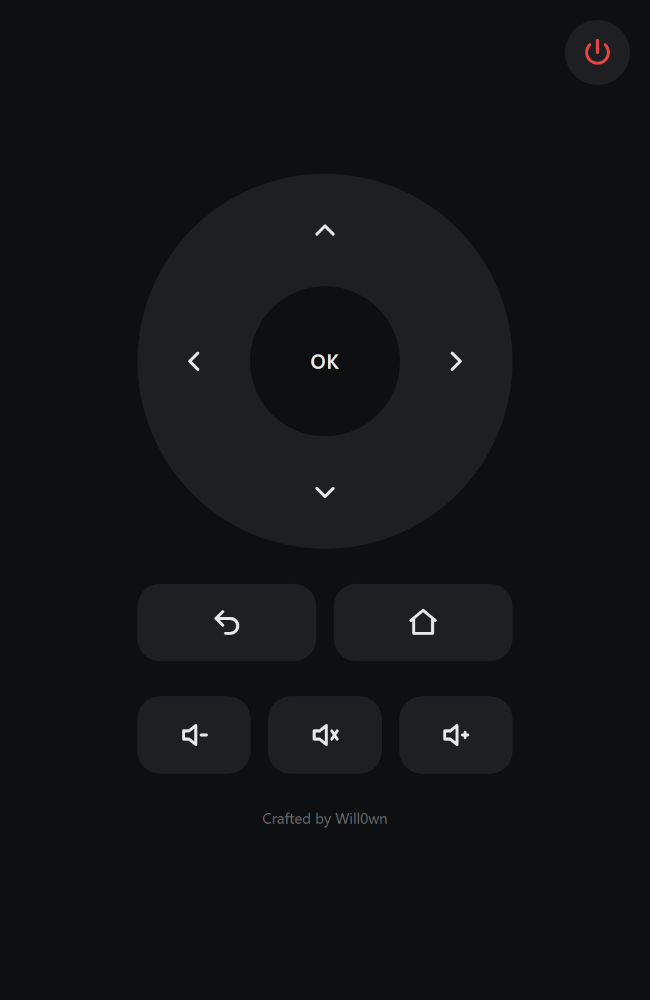

# WSALoader

A mod loader for Windows Subsystem for Android (WSA), plus **WSASmartTV**, a mod that turns WSA into
something you can use from the couch:

- **Android UI scale** for every app, applied each time WSA starts
- **Fullscreen apps**, every Android app opens in fullscreen
- **Phone remote**, a web page on your home network with a TV remote layout, a PIN and a power button

Mods run inside `WsaClient.exe`: no extra process, no background service, nothing patched on disk.



> Not affiliated with Microsoft. WSA is no longer distributed through the Microsoft Store (March 2025):
> WSALoader is meant for existing installs and community builds such as WSABuilds.

## Status

Early release (0.2.0). Tested on Windows 11 with:

- Projectivy Launcher
- Crunchyroll

## Install

1. Download `WSALoader-Setup-<version>.exe` from the Releases page and run it (administrator rights
   are required).
2. Pick the WSA folder (default `C:\Program Files\Windows Subsystem for Android`).
3. Choose the mods and the WSASmartTV settings: UI scale, phone remote on or off, remote PIN.
4. Open an Android app. For the remote, open `http://<PC IP>:8580` in the phone browser while WSA is
   running. The setup shows the exact address at the end.

The setup replaces `gfxstream_backend.dll` only after the loader has passed a load test inside the
WSA folder. If the test fails, WSA is left untouched.

Uninstall from **Settings > Apps > WSALoader**: the original DLL is put back.

## How it works

`WsaClient.exe` imports `gfxstream_backend.dll`, a DLL that exists only in the WSA folder. WSALoader
takes its place: it loads the original by full path, passes WsaClient's 24 imported functions
through `jmp` stubs, forwards the other exports, then loads every mod found in
`<WSA>\Custom\<Name>\<Name>.dll`.

Details, and how to write a mod: [`Custom/WSALoader/README.md`](Custom/WSALoader/README.md).
WSASmartTV settings and remote: [`Custom/WSASmartTV/README.md`](Custom/WSASmartTV/README.md).

## Project layout

| Path | Content |
| --- | --- |
| `Custom/` | the folder installed into WSA (DLLs are build output) |
| `src/WSALoader/` | loader source (`wsaloader.c`, `wsaloader.def`) |
| `src/WSASmartTV/` | mod source (`wsasmarttv.c`) |
| `installer/` | Inno Setup 7 script |
| `tools/` | build script and PE parsers |
| `docs/` | images |

## Build

Requirements: [Zig](https://ziglang.org) (extracted into the project folder as
`zig-x86_64-windows-<version>`) and [Inno Setup 7](https://jrsoftware.org/isdl.php).

```
pwsh -NoProfile -File tools\build.ps1
```

It builds the DLLs into `Custom\` and the setup into `installer\Output\`.
